  

  
  
  
  

  

### 🛠️ Toolbox

**Infrastructure & Security**

**Code & Data**

### 🔭 Currently tinkering with

- 🛡️ **NIS2 compliance tooling** — turning a heavy regulation into a checklist people actually use
- 🏠 **Home Assistant** automations — because the house should run itself
- 📡 **Omada network tooling** — naming every MAC on the network so nothing stays anonymous
- 🌐 **[lucianoblancato.it](https://www.lucianoblancato.it)** — my corner of the web, rebuilt with Astro

### 🐍 Contributions

<picture>
  <source media="(prefers-color-scheme: dark)" srcset="https://raw.githubusercontent.com/TheXeon81/TheXeon81/output/snake-dark.svg">
  
</picture>

Made in Catania 🌋 · uptime is a lifestyle

